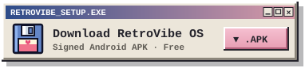
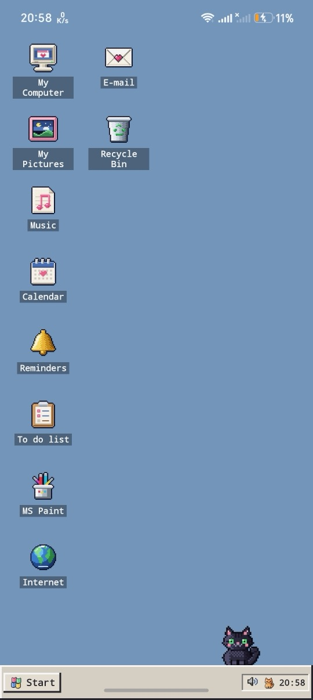
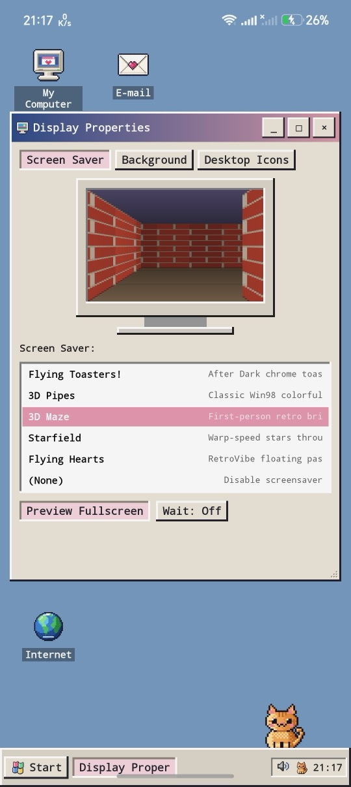
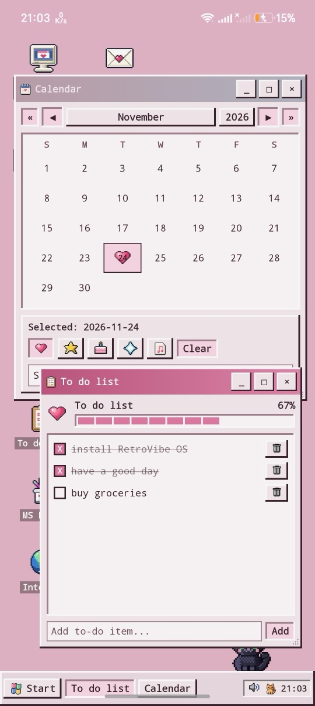
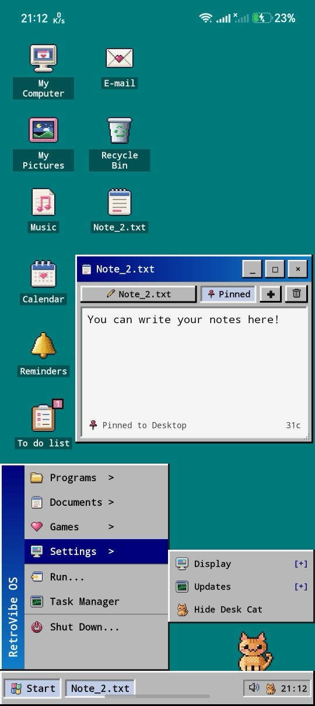
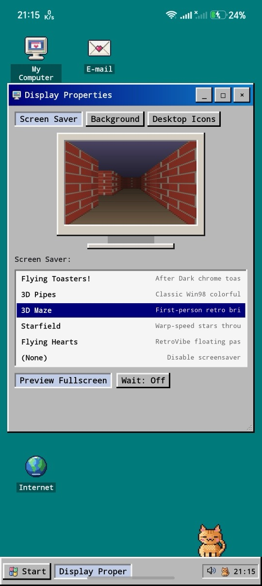
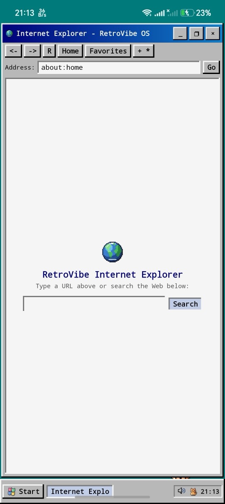

   
   
  

---

### `C:\RETROVIBE\SCREENSHOTS\`

#### `01. Pastel Denim Theme`

| Desktop & Spooks | Display Properties & 3D Maze |
| :---: | :---: |
|  |  |
| **Home Desktop** — Handcrafted 32×32 pixel icons with **Spooks** (fluffy black cat with green eyes) relaxing on the taskbar. | **Display Properties** — Live **3D Brick Maze** preview inside the CRT monitor with **Mindi** (ginger cat) watching below. |

---

#### `02. Y2K Strawberry Milk Theme`

| Multitasking: Mail, Pictures & Music | Calendar & To-Do List |
| :---: | :---: |
|  |  |
| **Draggable Windows** — Run **RetroVibe Express Mail**, **My Pictures**, and the **Music Player (`Playlist.wpl`)** side by side. | **Daily Planning** — Stamp special days with pixel stickers on **Calendar** and check off tasks with the retro **To do list** progress bar. |

| MS Paint & Purring Mindi | HeartSweeper |
| :---: | :---: |
|  |  |
| **MS Paint** — Classic 16-tool drawing app with flood fill, opaque/transparent selection, and 28-color palette—plus **Mindi** purring when you pet him. | **HeartSweeper** — Custom heart-shaped Minesweeper built for phones with long-press flagging, zoom, and smart chording. |

---

#### `03. Classic Win98 Teal Theme`

| Pinned Desktop Notes & Start Menu | Classic Win98 Display & Screensavers |
| :---: | :---: |
|  |  |
| **Notes & Start Menu** — Pin sticky `.txt` notes straight onto the desktop and browse apps from the classic cascading **Start** menu. | **Retro Screensavers** — Switch between **Flying Toasters**, **3D Pipes**, **3D Maze**, **Starfield**, and **Flying Hearts** with live monitor previews. |

| Internet Explorer Homepage | Live Web Browsing |
| :---: | :---: |
|  |  |
| **Internet Explorer** — Nostalgic browser start screen with Favorites and address bar. | **Surf the Web** — Search and browse real websites right inside a classic Windows 98 window. |

---

  

  <code>Start &gt; Programs &gt; RetroVibe OS</code> · Built natively with Kotlin &amp; Jetpack Compose

