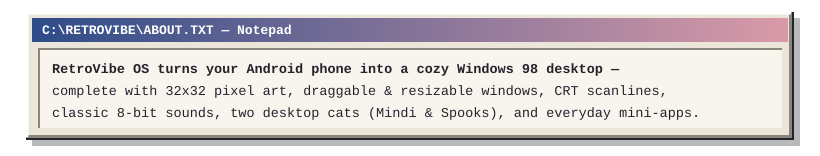
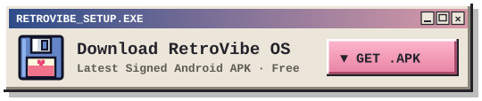
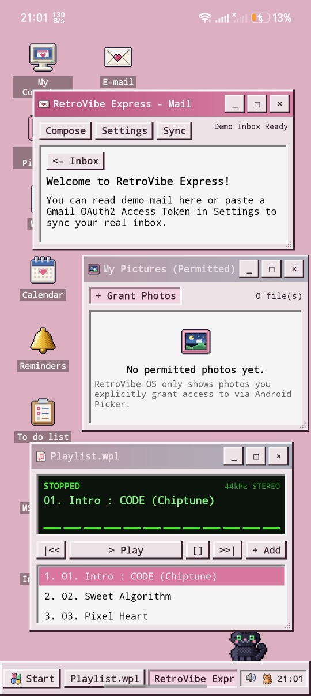
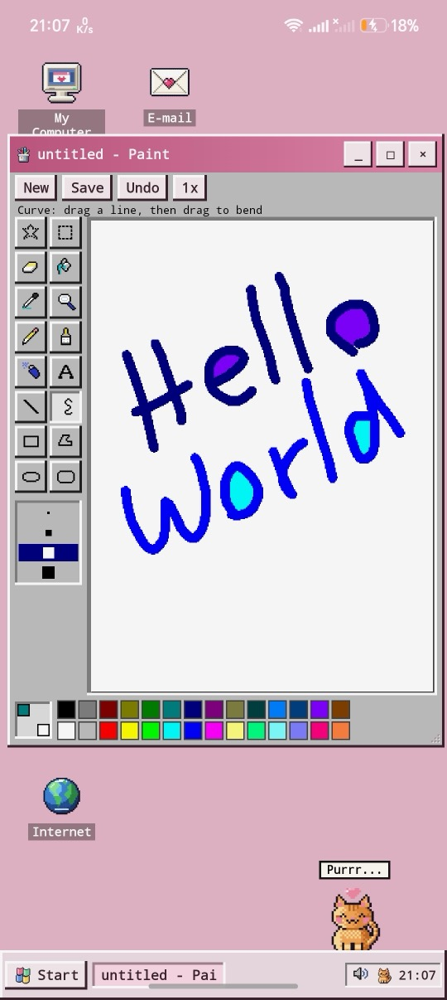
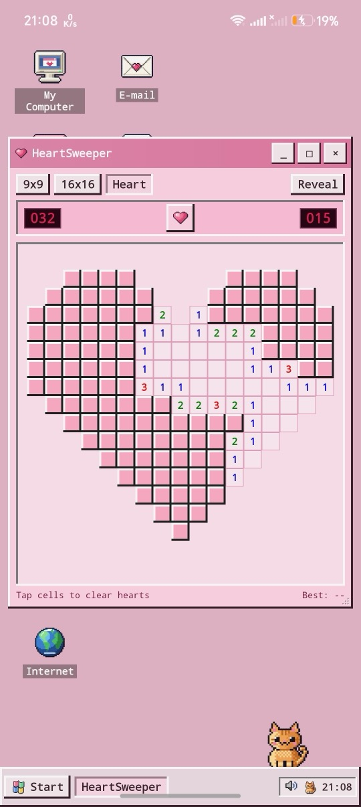
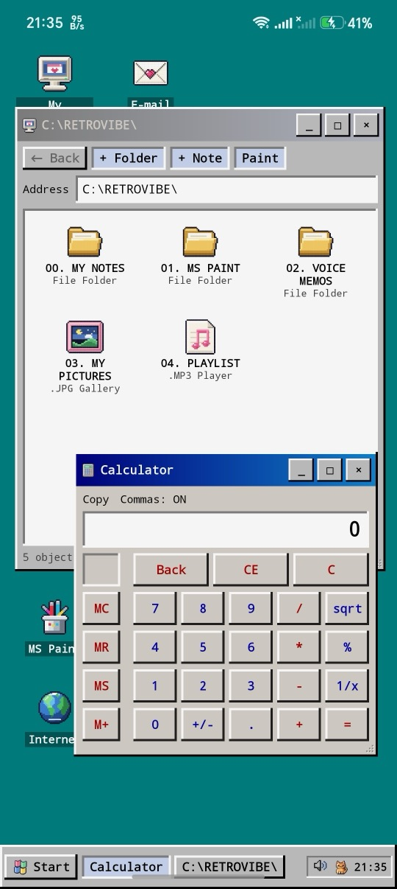
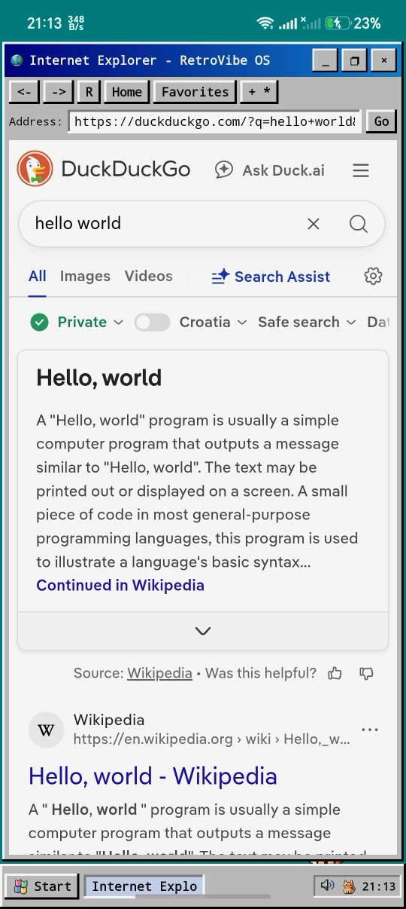
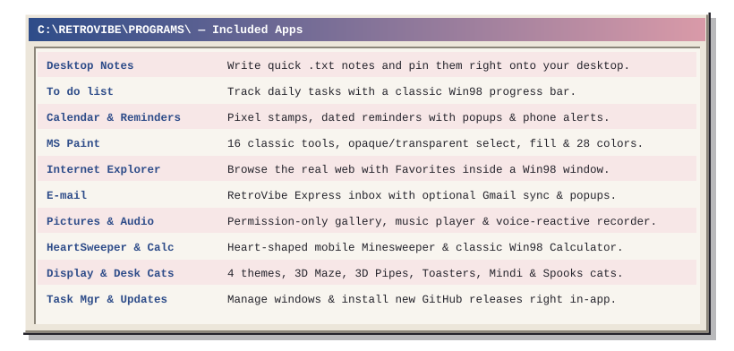

  

  

  

---

### `C:\RETROVIBE\SCREENSHOTS\`

#### `01. Pastel Denim Theme`

<table>
  <tr>
    <td align="center" width="50%">
      <strong>Desktop &amp; Spooks</strong>  
        
      Handcrafted 32×32 pixel icons with <strong>Spooks</strong> (fluffy black cat with green eyes) relaxing on the taskbar.
    </td>
    <td align="center" width="50%">
      <strong>Display Properties &amp; 3D Maze</strong>  
        
      Live <strong>3D Brick Maze</strong> preview inside the CRT monitor with <strong>Mindi</strong> (ginger cat) watching below.
    </td>
  </tr>
</table>

#### `02. Y2K Strawberry Milk Theme`

<table>
  <tr>
    <td align="center" width="50%">
      <strong>E-mail, My Pictures &amp; Music</strong>  
        
      Check your inbox in <strong>RetroVibe Express</strong>, view chosen photos in <strong>My Pictures</strong>, and listen to tracks in the <strong>Music Player</strong>.
    </td>
    <td align="center" width="50%">
      <strong>Calendar &amp; To-Do List</strong>  
        
      Stamp special days with pixel stickers on <strong>Calendar</strong> and check off tasks on <strong>To do list</strong>.
    </td>
  </tr>
  <tr>
    <td align="center" width="50%">
      <strong>MS Paint &amp; Purring Mindi</strong>  
        
      Classic 16-tool <strong>MS Paint</strong> with flood fill, opaque/transparent select &amp; 28 colors—plus <strong>Mindi</strong> purring when petted.
    </td>
    <td align="center" width="50%">
      <strong>HeartSweeper</strong>  
        
      Custom heart-shaped Minesweeper built for phones with long-press flagging, zoom, and smart chording.
    </td>
  </tr>
</table>

#### `03. Classic Win98 Teal Theme`

<table>
  <tr>
    <td align="center" width="50%">
      <strong>Pinned Notes &amp; Start Menu</strong>  
        
      Pin sticky <code>.txt</code> notes straight onto the desktop and browse apps from the classic cascading <strong>Start</strong> menu.
    </td>
    <td align="center" width="50%">
      <strong>My Computer &amp; Calculator</strong>  
        
      Browse folders in <strong>C:\RETROVIBE\</strong> (notes, paint, voice memos, pictures &amp; music) and use the classic Win98 <strong>Calculator</strong>.
    </td>
  </tr>
  <tr>
    <td align="center" width="50%">
      <strong>Internet Explorer Homepage</strong>  
        
      Nostalgic browser start screen with Favorites and classic Win98 address bar.
    </td>
    <td align="center" width="50%">
      <strong>Live Web Browsing</strong>  
        
      Search and browse real websites right inside a classic Windows 98 window.
    </td>
  </tr>
</table>

---

  

  <code>Start &gt; Programs &gt; RetroVibe OS</code> · Built natively with Kotlin &amp; Jetpack Compose

