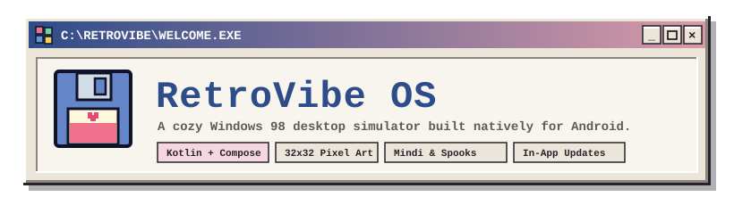

  

  

---

### `C:\RETROVIBE\ABOUT.TXT`

**RetroVibe OS** turns your Android phone into a nostalgic Windows 98 desktop — complete with draggable & resizable windows, pixel icons, classic 8-bit sounds, and everyday mini-apps.

### `C:\RETROVIBE\PROGRAMS\`

| Program | What it does |
| :--- | :--- |
| **Desktop Notes** | Take quick notes and pin them right on your desktop. |
| **To do list** | Track daily tasks with a retro progress bar. |
| **Internet Explorer** | Browse the web with a 56k dial-up intro and Favorites. |
| **E-mail** | Retro inbox with optional Gmail sync and *"You've Got Mail!"* alerts. |
| **Calendar & Reminders** | Monthly calendar with pixel stamps and popup reminders. |
| **MS Paint** | Classic 16-tool drawing app with flood-fill bucket and 28-color palette. |
| **My Pictures & Music** | Permission-only photo viewer, local music player, and Sound Recorder. |
| **HeartSweeper & Calculator** | Custom heart-shaped Minesweeper and a Win98 Calculator. |
| **Display & Screensavers** | Themes, custom wallpapers, CRT scanlines, Flying Toasters, 3D Pipes, 3D Maze, and an optional Desk Cat. |
| **Task Manager & Updates** | Manage open windows, check device stats, and pull new versions straight from GitHub. |

---

  <code>Start &gt; Programs &gt; RetroVibe OS 98</code> · Built with Kotlin &amp; Jetpack Compose

